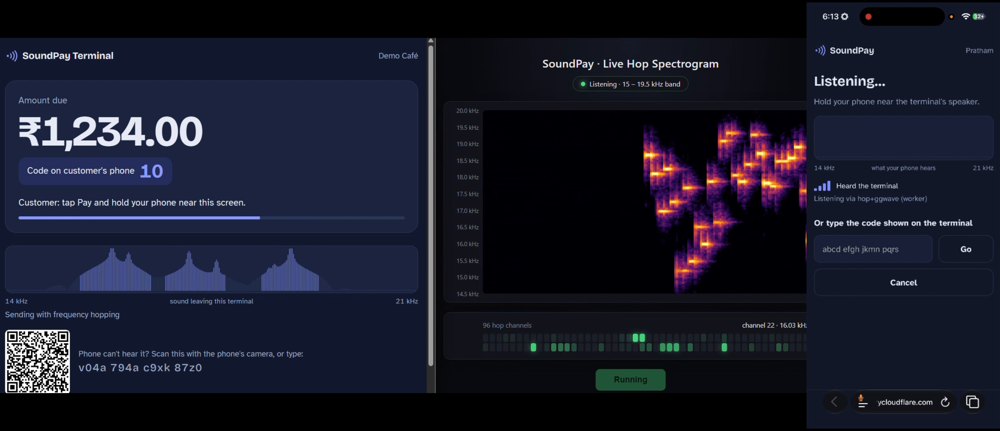
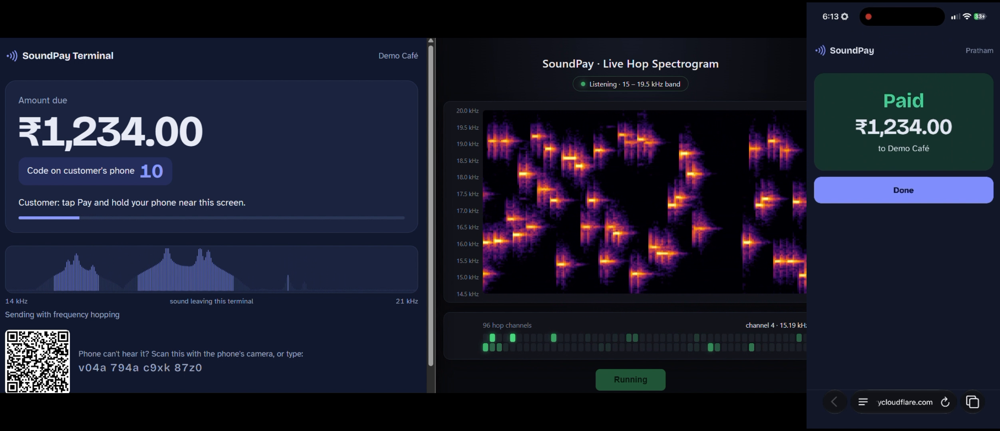

# SoundPay

**Pay with sound, and keep paying when someone is jamming the room.**

SoundPay is a contactless payment prototype with no card reader. The shop's web terminal plays a short, near-silent audio code (about 15–19.5 kHz). The customer's phone hears it, shows the shop and amount, and the customer approves with a passkey (fingerprint / face).

The token travels over a **keyed frequency-hopping acoustic modem** built for this project: 96 channels, a new hop pattern every broadcast, Reed-Solomon error correction, and adaptive channel selection. In simulation it keeps working under jamming that stops plain [ggwave](https://github.com/ggerganov/ggwave) completely.

> Built at **Confluence** · **3rd place** · Team: Pratham Kashyap, Sparsh Som, Praguna Krishna, Tanay



*Recorded live on a laptop and a phone. The spectrogram shows the payment tone hopping across channels.*

**Demo video:** [link to video, or add `docs/demo.mp4`]

**Contents:** [Demo](#demo) · [How it works](#how-it-works) · [Quick start](#quick-start) · [Real phone](#use-a-real-phone) · [Stripe](#stripe-test-mode) · [Sound modes](#sound-modes) · [Testing](#testing) · [Security](#security-design) · [Structure](#project-structure) · [Limitations](#known-limitations) · [Credits](#credits)

## Demo

The payment completes on the phone after the passkey approval:



**Jam Lab** (`/lab/`) lets you try to jam a payment in a simulated room, ggwave against the hop modem, with no phone needed. Two simulated results (not real hardware):

- A random-channel jammer on 25% of the band: ggwave 0%, hop modem gets through.
- An attacker replaying the previous broadcast: fixed channels 0%, hopping about 97%, because every broadcast uses a new key-derived pattern.

`npm run build:lab` writes a single offline file, `dist/jam-lab.html`. Presenter's script: [docs/DEMO.md](docs/DEMO.md).

## How it works

```
POS (laptop)                       Server                         Phone
────────────                       ──────                         ─────
Charge ₹450 ───────────────▶ create session {token, ₹450, code 46}
play token over sound ~~~~~~~~~~~~~~~~~~~~~~~~~~~~~~~~~~~~~~~▶ hears token
                                    ◀─────────────────────────── lookup(token)
                                    ──── Demo Café, ₹450, code 46 ▶ shows confirm screen
                                                                   user checks code matches POS
                                    ◀──────────── passkey approval for THIS payment
                             verify passkey
                             claim token (once, atomically)
                             charge card (Stripe / mock)
"Paid by Pratham." ◀── live event ─────
```

The audio carries only a 16-character token. The amount lives on the server, and nothing is charged until the customer sees the shop and amount and approves with a passkey.

## Quick start

Requires Node 22.13 or newer (uses the built-in `node:sqlite`). No Stripe account needed.

```
npm install
npm run demo          # mock payments, POS key "demo"; prints the links below
```

- **Terminal** `/pos.html` and **phone** `/pay.html`: a real payment. One laptop works (two windows).
- **Jam Lab** `/lab/`: jam a simulated payment, ggwave vs the hop modem.
- **Range test** `/rangetest.html`: measure distance on real devices and calibrate the speaker.

To run with your own settings:

```
cp .env.example .env      # set POS_KEY
npm start
```

Open `http://localhost:3000`, with the POS in one tab and the pay page in another; the laptop's speakers and mic carry the signal. Approve with your laptop's fingerprint / Windows Hello, or use Chrome DevTools > More tools > WebAuthn > "Enable virtual authenticator".

Status and planned improvements: [docs/REPORT.md](docs/REPORT.md).

## Use a real phone

Phones need **https** for the microphone and passkeys.

```
cloudflared tunnel --url http://localhost:3000      # or: ngrok http 3000
```

1. Put the printed `https://….trycloudflare.com` URL in `.env` as `ORIGIN`, then restart.
2. Open that URL on the laptop (POS) **and** the phone (pay page).

Passkeys are tied to the hostname, and a quick tunnel gets a new URL on every run, so accounts made on the old URL stop working. For a fixed URL, use a named tunnel or deploy (Render / Railway).

## Stripe test mode

1. Add your test keys (`sk_test_…`, `pk_test_…`) to `.env`.
2. Run `stripe listen --forward-to localhost:3000/api/webhooks/stripe` and put the printed `whsec_…` in `STRIPE_WEBHOOK_SECRET`.
3. Restart. Save card `4242 4242 4242 4242`. Card `4000 0025 0000 3155` triggers a 3-D Secure popup, which the phone handles.

Stripe India is invite-only for new accounts, but test mode works on any existing account. `server/payments.js` is the only file to change for Razorpay.

## Sound modes

By default the token travels over a **frequency-hopping modem** (`public/hop/`, details in [docs/HOPMODEM.md](docs/HOPMODEM.md)) instead of ggwave.

**How hopping works**

- 96 tones between 15 and 19.5 kHz. Every 64 ms the signal jumps to a key-chosen channel, and every 3-second broadcast uses a new pattern, so a recording of one broadcast can't predict the next.
- The server keeps one master secret and hands out a separate key for each 30 seconds, only to signed-in customers with a card and to the signed-in POS (`/api/hop/keys`, `/api/pos/hop/keys`).
- The POS starts each frame on a 3-second boundary of the server clock (`/api/time`). The phone decodes in a Web Worker fed by an AudioWorklet, and uses the clock to pick the right pattern.
- Reed-Solomon repairs jammed or unreadable slots. The receiver filters out everything below 12 kHz, blanks hammer-blow impulses, and ignores channels a jammer sits on.

**Adaptation and fallbacks**

- **Adaptive hopping:** phones report channels that stay noisy (machine whine, ultrasonic beacons, pest repellers, jammers) to `/api/hop/report`. The server schedules a new channel set two cycles ahead, and the POS and every phone switch on the same frame. At most 32 channels are ever left out.
- **Speaker calibration:** the range-test page measures how loud each tone arrives, and phones refine it after each payment. The POS boosts weakly played tones (boost only, up to +5.6 dB) and skips ones it can't play.
- **Several terminals in one shop:** set `TDMA_SLOT=k/N` so terminal k only sends on every N-th cycle.
- **Phones that can't hear the band:** a QR code on the POS (`/pay.html#t=<token>`, new every sale) and a typed code.
- **On the phone:** a signal meter ("move closer", "very loud here"), vibration when the terminal is heard, and "Read this aloud" on the confirm screen.

Hopping buys **jamming resistance, not secrecy**. The token was always public (the passkey and the one-time claim protect the money), and every signed-in customer can get the keys.

### `AUDIO_MODE`

| `AUDIO_MODE`    | POS sends                            | Phone listens for |
|-----------------|--------------------------------------|-------------------|
| `hop` (default) | hop frames                           | hop + ggwave      |
| `both`          | hop and ggwave on alternating cycles | hop + ggwave      |
| `ggwave`        | ggwave only                          | ggwave            |

The POS also falls back to ggwave if the browser can't run audio at 48 kHz or can't get keys.

### `HOP_PROFILE`

Picks the hop layout. None is best everywhere (see [docs/HOPMODEM.md](docs/HOPMODEM.md)).

| `HOP_PROFILE`    | Frame / cycle | Charge → confirm (headless Chromium) | Survives                                                           | Loses to                                 |
|------------------|---------------|--------------------------------------|--------------------------------------------------------------------|------------------------------------------|
| `fast` (default) | 2.56 s / 3 s  | about 3.5 s                          | random and replayed jamming, sweeps                                | a follower or any fast-moving decoy tone |
| `robust`         | 4.61 s / 5 s  | about 7 s                            | follower / moving decoys, a second terminal, sweeps, light jamming | many channels jammed continuously        |
| `range`          | 3.58 s / 4 s  | about 5 s                            | like fast, with more distance and jam margin (RS(48,16))           | a follower                               |

ggwave takes about 2 s and survives none of the jammers.

## Testing

```
npm test
```

40 Node tests cover the payment flow and the modem:

| Area             | What it proves                                                                                                                                                                  |
|------------------|---------------------------------------------------------------------------------------------------------------------------------------------------------------------------------|
| Payment flow     | Happy path (hear → lookup, no charge → passkey → charged → POS sees "Paid"); two phones with one token charge exactly one (other gets 409); an approval for payment A can't pay B; someone else's passkey can't approve; expired / cancelled payments are refused, even if approval lands after expiry |
| Access and events | Sign-in, card, POS key and cross-site POST rules; the POS receives CLAIMED then PAID                                                                                           |
| Audio round-trip | Token survives 25% volume plus noise, takes < 2.5 s, energy sits above 14 kHz                                                                                                   |
| Hop API          | `/api/time`; keys need sign-in + card (customer) or the POS login; server keys match the browser's derivation byte for byte; the master secret never leaves; rate limit          |
| Link adaptation  | Noisy-channel reports are validated, capped at 32 and scheduled two cycles ahead on a boundary; calibration gives boost-only gains; reset                                       |
| Hop modem        | Hop plans, round trips, wrong key fails, Reed-Solomon limits, clock sync, sub-band and repetition modes                                                                          |
| Hop stream       | Streaming decoder hears every broadcast from mic-sized chunks, with clock errors of several seconds, across key epochs, with 25% of channels jammed; wrong keys / other terminals hear nothing; robust profile under a follower; the channel monitor finds a whine under loud speech |

The API tests use a software passkey, so the real WebAuthn signature checks run.

### Real-browser tests

```
npm i -D playwright && npx playwright install chromium
npm run test:browser                   # all runs below
node test/browser/e2e.mjs hop          # or: ggwave, both, qr;  2nd argument: fraction jammed (0.25) or follower32
HOP_PROFILE=robust node test/browser/e2e.mjs hop follower32
E2E_NO_WORKER=1 node test/browser/e2e.mjs hop        # also E2E_NO_WORKLET=1: the fallback paths
node test/browser/rangetest.mjs        # range-test page: calibration through a weak speaker, then a recording
```

Headless Chromium opens the POS and the phone page. Every audio buffer the POS schedules is played into the phone page's microphone (a controlled MediaStream with room noise). The phone's real AudioWorklet → Web Worker receiver decodes it, a virtual passkey approves, and both screens must show Paid. With channels jammed it also checks that the phone's reports made the POS hop around them. `qr` pays through the QR code instead of sound. This checks browser code paths, not speakers, microphones or rooms.

### Simulations

```
node tools/hopsim/sim-attacks.js 100   # ggwave vs fixed vs the hop profiles under 14 attacks
node tools/hopsim/sim-noise.js 100     # construction, speech, whine, pest repeller, clipping, 2nd terminal, distance
node tools/hopsim/sim.js 300           # repetition vs Reed-Solomon, hopping vs fixed
node tools/hopsim/sim-clock.js 100     # clock-error tolerance
```

## Security design

| Hole                                | Fix                                                                                                                                    | Where                          |
|-------------------------------------|----------------------------------------------------------------------------------------------------------------------------------------|--------------------------------|
| Rogue speaker charges nearby phones | Nothing is charged until the user sees shop + amount and approves with a passkey                                                       | `pay.js`, `/api/pay/confirm`   |
| Wrong customer in the queue         | Same approval step, plus the POS shows who is paying                                                                                   | `pos.js`                       |
| Relay to another location           | 2-digit match code: phone and POS must show the same number                                                                            | `match_code`                   |
| Double charge race                  | One SQL `UPDATE … WHERE status='OPEN' … RETURNING` claims the token                                                                    | `sessions.js` `claimSession`   |
| Approval replay                     | Passkey challenge is tied to one user and one payment, single use                                                                      | `passkeys.js`                  |
| Amount tampering                    | Amount lives only on the server; the audio carries just the token                                                                      | `/api/pos/sessions`            |
| Retry double charge                 | Stripe idempotency key = token                                                                                                         | `payments.js`                  |
| Passive listening                   | Mic only opens after the user taps Pay, closes after                                                                                   | `audio.js`                     |
| CSRF                                | Origin check on every POST, SameSite cookies                                                                                           | `index.js`                     |
| Jamming the payment (DoS)           | Keyed frequency hopping with a new pattern per broadcast, Reed-Solomon, jammer excision; `HOP_PROFILE=robust` against follower jammers | `public/hop/`, `server/hop.js` |

## Project structure

```
server/
  index.js      routes                      sessions.js   payment tokens + the atomic claim
  passkeys.js   WebAuthn register / sign-in / approve-a-payment
  payments.js   Stripe or mock (UPI design: docs/UPI.md)
  events.js     live updates to the POS (Server-Sent Events)
  hop.js        hop master secret + per-30-second keys
  link.js       adaptive hopping, speaker calibration, TDMA
  users.js, db.js, tokens.js, config.js
public/
  pos.html/js   shop terminal (with QR fallback)
  pay.html/js   customer phone (signal meter, read-aloud, QR landing)
  rangetest.*   range test + speaker calibration
  audio.js      send / receive (hop + ggwave) + live spectrum strip
  hop/          the frequency-hopping modem (browser and Node)
    modem.js      tones, frames, sync, excision, high-pass, impulse blanking, decoding
    rs.js         Reed-Solomon over GF(64)      hop.js       keyed hop plans
    timing.js     server clock, epoch keys      profiles.js  fast / robust / range, link schedule
    stream.js     streaming decoder for live mic audio
    monitor.js    noisy channels, signal stats, calibration maths
    token.js      16-char token <-> 10 bytes
    engine.js, worker.js   decoder in a Web Worker      mic-worklet.js   AudioWorklet mic tap
  lab/          Jam Lab (engine.js, models.js, lab.js/css, index.html)
test/           npm test;  test/browser/  real-browser runs (e2e.mjs, rangetest.mjs)
tools/          hopsim/ simulations;  demo.mjs (npm run demo);  build-lab.mjs (npm run build:lab)
docs/           HOPMODEM.md · REPORT.md · UPI.md · DEMO.md · screenshots/
```

## Known limitations

<<<<<<< HEAD
This is a working prototype. In the time of scaling, we plan to fix these before handling real money : 
=======
This is a working prototype. Before handling real money, these need fixing:
>>>>>>> 907804a (SoundPay: frequency-hopping acoustic payments)

**Scaling and payments**

- Pending passkey challenges and rate limits live in memory, so run one server process. Move them to Redis or the database to scale out.
- Link adaptation state (noisy channels, calibration) is per server and for one terminal id. Several terminals need their own `TERMINAL_ID` and `TDMA_SLOT`, and today one server process each.
- Payments are card-only (Stripe or mock). UPI is designed ([docs/UPI.md](docs/UPI.md)), not built.

**Audio**

- **Limited real-device testing.** A full payment has run end to end on a real laptop and phone (see the demo video), but the range, jamming-resistance and noise numbers in the docs come from simulation and headless Chromium. Real speakers, microphones and rooms can change them a lot. Measure your own setup with `/rangetest.html`, and keep `AUDIO_MODE=both` or `ggwave` handy.
- Some people (mostly under 25) can faintly hear 15 kHz. ggwave's ultrasonic mode starts there.
<<<<<<< HEAD
- Cheap laptop speakers vary a lot above 16 kHz. We can calibrate on the actual laptop (`/rangetest.html`) and keep
  the QR / typed-code fallback.
- The hop modem has only been tested in simulation and in headless Chromium. Real speakers, microphones and
  rooms are untested:We should try it on our/your own laptop and phones, and keep `AUDIO_MODE=both` or `ggwave` handy.
- A fast-moving jammer (one strong decoy tone that changes every few tens of ms, or a follower) defeats
  ggwave and the `fast` and `range` profiles. Use `HOP_PROFILE=robust` where that's a threat. See "What it
  does not stop" in [docs/HOPMODEM.md](docs/HOPMODEM.md).
- ggwave still uses `ScriptProcessorNode` for the mic because it works on every phone browser. The hop
  receiver uses an `AudioWorklet` and a Web Worker, and falls back to the ScriptProcessor on old browsers.

**Security**
- Hop keys go to every signed-in customer with a card, and registration is open. Anyone who signs up can
  follow the hops, so hopping stops outsiders who jam, not insiders.
=======
- Cheap laptop speakers vary a lot above 16 kHz. Calibrate on the actual laptop and keep the QR / typed-code fallback.
- A fast-moving jammer (one strong decoy tone changing every few tens of ms, or a follower) defeats ggwave and the `fast` and `range` profiles. Use `HOP_PROFILE=robust` where that's a threat. See "What it does not stop" in [docs/HOPMODEM.md](docs/HOPMODEM.md).
- ggwave still uses `ScriptProcessorNode` for the mic because it works on every phone browser. The hop receiver uses an `AudioWorklet` and Web Worker, and falls back to the ScriptProcessor on old browsers.

**Security**

- Hop keys go to every signed-in customer with a card, and registration is open. Anyone who signs up can follow the hops, so hopping stops outsiders who jam, not insiders.

## Credits

- **Team:** Pratham Kashyap, Sparsh Som, Praguna Krishna, Tanay
- **Data-over-sound base and passkey approval flow:** Sparsh Som's original SoundPay, built on [ggwave](https://github.com/ggerganov/ggwave) by Georgi Gerganov.
- **Frequency-hopping modem, adaptive hopping, Jam Lab and simulations:** [your name / exactly what you wrote].
- Thanks to [organizers / host institution] and everyone at Confluence.

## License

ISC (see `package.json`). Add a `LICENSE` file before publishing. ggwave is MIT-licensed.
>>>>>>> 907804a (SoundPay: frequency-hopping acoustic payments)
